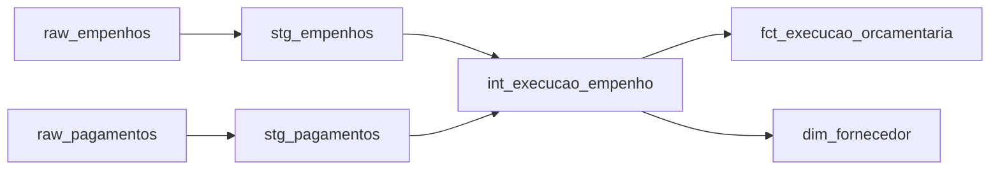

# 🏅 dbt Medallion Analytics — Execução Orçamentária

Projeto **dbt** que modela dados de execução orçamentária (empenhos e pagamentos) em **camadas** — raw → processed → trusted → gold — com **testes de qualidade** e documentação gerada automaticamente.
Roda localmente com **DuckDB** (zero infraestrutura) e o mesmo código vai para **BigQuery** trocando o target.


## Linhagem



| Camada | Pasta | Materialização | Papel |
|---|---|---|---|
| raw | `seeds/` | seed | Dados de origem (sintéticos) |
| processed | `models/staging` | view | Tipagem e padronização |
| trusted | `models/intermediate` | view | Regras de negócio (remove anulados, calcula saldo) |
| gold | `models/marts` | table | Fatos e dimensões para BI |

## Como executar

```bash
pip install -r requirements.txt
export DBT_PROFILES_DIR=.
dbt build              # seeds + modelos + 18 testes
dbt docs generate && dbt docs serve   # documentação e linhagem no navegador
```

Para BigQuery: `pip install dbt-bigquery`, defina `GCP_PROJECT` e rode `dbt build --target bigquery`.

## Testes de qualidade

- `unique` / `not_null` nas chaves
- `accepted_values` para situação do empenho
- `relationships` (todo pagamento aponta para um empenho existente)
- Teste singular: **valor pago nunca excede o valor empenhado**

---
Autor: [Carlos Absalão](https://www.linkedin.com/in/carlos-absalao-dados-ia) · Licença MIT
